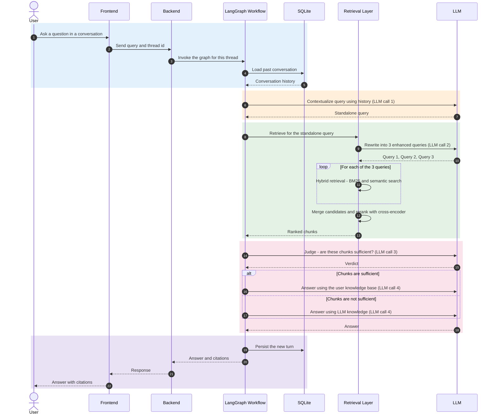
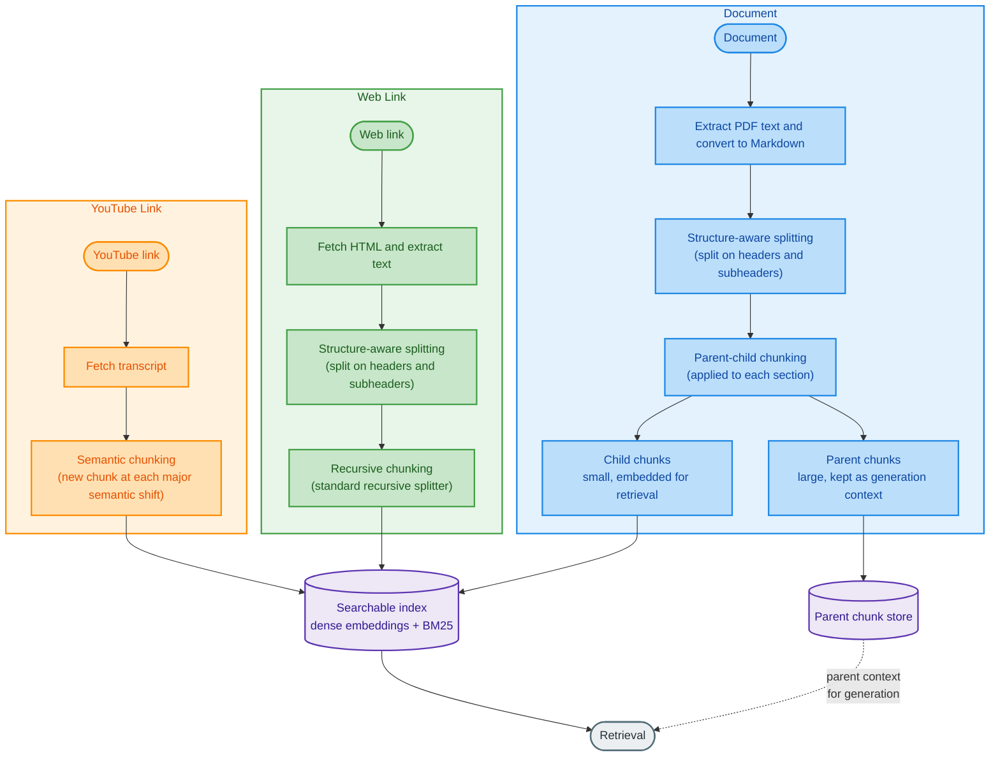
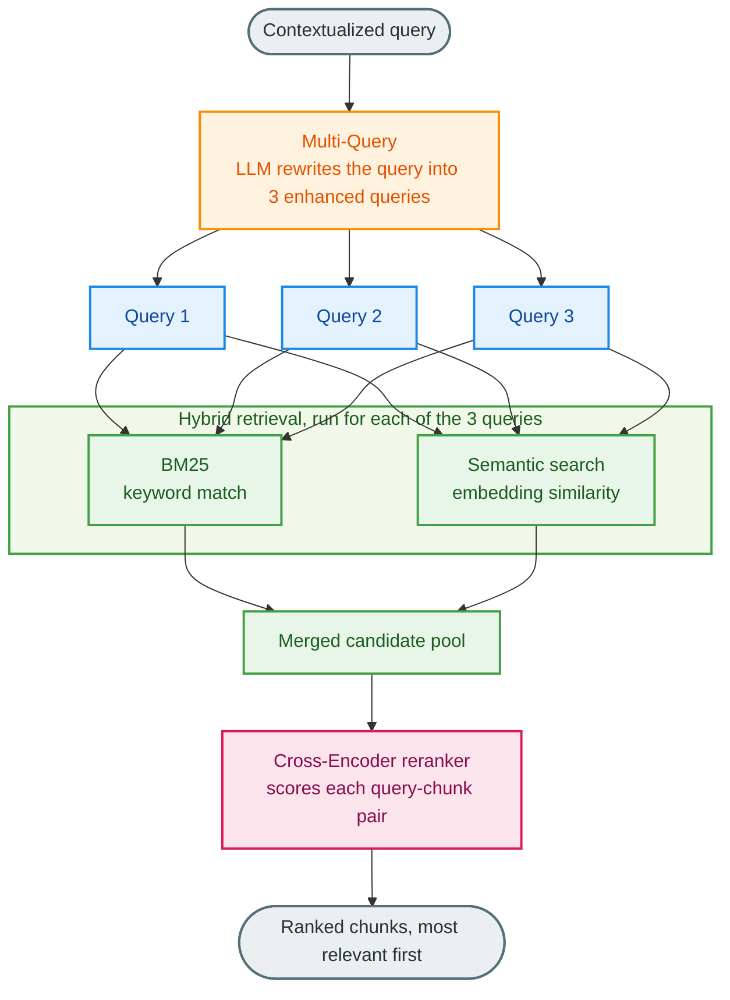
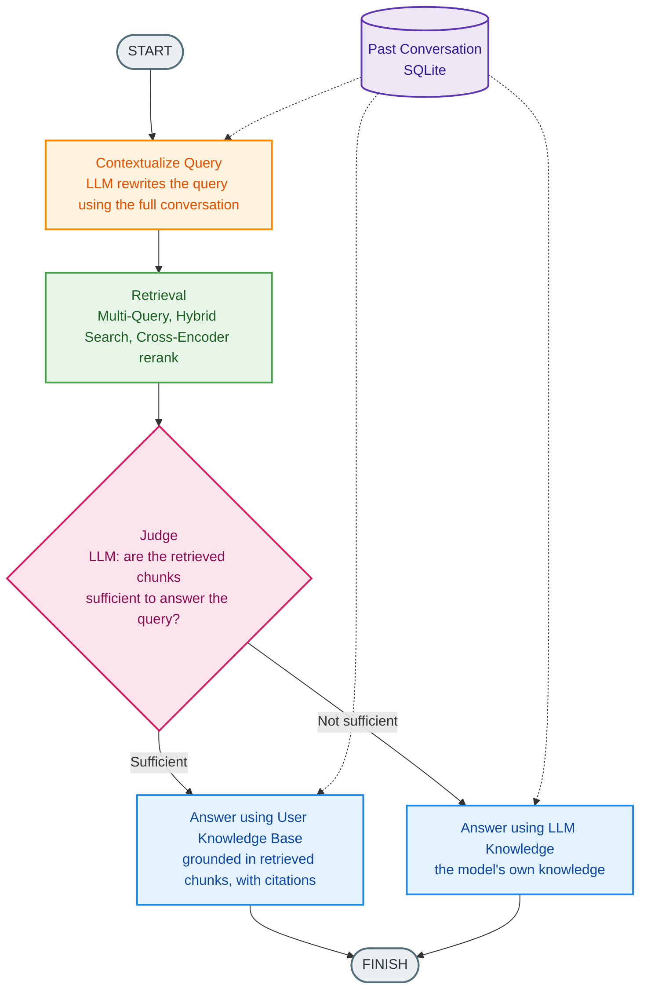
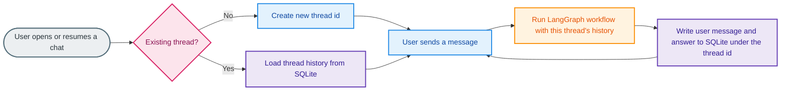

# Multipurpose-RAG

A multi-purpose Retrieval-Augmented Generation (RAG) system that lets you chat with **Documents**, **Web Links** and **YouTube Videos**. Each modality has its own ingestion and chunking strategy. The retrieval layer is built with **LangChain** and sits inside a larger decision-making workflow built with **LangGraph**. Conversations are persisted in **SQLite**, so a chat can be resumed and each follow-up question is understood in context.

---

## Table of contents

- [Highlights](#highlights)
- [Repository Structure](#repository-structure)
- [How a Single Query Flows Through the System](#how-a-single-query-flows-through-the-system)
- [Ingestion and Chunking](#ingestion-and-chunking)
- [Retrieval Layer (LangChain)](#retrieval-layer-langchain)
- [Workflow Orchestration (LangGraph)](#workflow-orchestration-langgraph)
- [Persistence, Threads and the Database](#persistence-threads-and-the-database)
- [Citations](#citations)
- [LLM Call Budget](#llm-call-budget)
- [Design Decisions](#design-decisions)
- [Limitations](#limitations)
- [Future Work](#future-work)
- [Tech Stack](#tech-stack)
- [Getting Started](#getting-started)

---

## Highlights

- **Three modalities, three strategies.** Documents, web pages and YouTube transcripts are each ingested and chunked in the way that suits their structure.
- **Advanced retrieval.** Multi-query rewriting, hybrid search (BM25 and semantic) and cross-encoder reranking.
- **Self-assessing answers.** An LLM judge decides whether the retrieved context is sufficient. If it is, the answer is grounded in the user's knowledge base. If it is not, the system answers from the LLM's own knowledge.
- **Conversation-aware.** Every query is rewritten into a standalone query using the full conversation history, so ambiguous follow-ups such as "what about the second one?" still retrieve correctly.
- **Persistent conversations.** Chat history is stored in SQLite and organised into threads.
- **Citations.** For the document and web modalities.

---

## Repository Structure

```text
Multipurpose-RAG/
├── backend/     # Server-side application: API, LangGraph workflow, conversation persistence
├── frontend/    # Chat user interface
├── rag/         # RAG layer: ingestion, chunking, indexing and retrieval (LangChain)
├── .gitignore
└── README.md
```
---

## How a Single Query Flows Through the System

The diagram below follows one user question from the UI to the final answer. Ingestion happens before this point, when the user adds a Document, Web Link or YouTube Video (see [Ingestion and Chunking](#ingestion-and-chunking)).



---

## Ingestion and Chunking

Chunking quality sets the ceiling for retrieval quality, so each source type gets its own pipeline instead of one generic splitter.



### 1. Documents: Structure-Aware Splitting and Parent-Child Chunking

1. **Convert to Markdown.** The document's text is converted to Markdown so that its structure (headings and subheadings) is explicit.
2. **Structure-aware splitting.** The Markdown is split on headers and subheaders. Each resulting section is a coherent unit of the document rather than an arbitrary window of characters.
3. **Parent-child chunking** is applied to each section:
   - **Child chunks** are small. They are embedded and used for retrieval, because a small, focused chunk produces a richer and more specific embedding than a large one.
   - **Parent chunks** are the larger passages the children came from. They are used as context during answer generation, so the LLM sees enough surrounding text to answer properly.

Documents such as PDFs often contain long bodies of text under a single heading. That is where parent-child chunking helps: you retrieve with precision and generate with context.

### 2. Web links: Structure-Aware Splitting and Recursive Chunking

1. **Extract text** from the page's HTML.
2. **Structure-aware splitting** on headers and subheaders, as with documents.
3. **Standard recursive chunking** on each section.

Parent-child chunking is deliberately *not* used here. Web pages usually do not contain the long, dense bodies of text that PDFs do, so a second chunk level adds complexity without much benefit.

### 3. YouTube Transcripts: Semantic Chunking

A transcript has no headings or sections to split on, so structure-aware splitting is not possible. Instead, the transcript is split using **semantic chunking** with a LangChain library:

- The transcript is treated as a sequence of sentences.
- The semantic similarity between each sentence and the next is measured.
- A new chunk starts wherever there is a major shift in meaning, so each chunk covers a single topic.

<!-- VERIFY: name the exact splitters/classes used (e.g. Markdown header splitter, recursive character splitter, semantic chunker), the parent/child chunk sizes, the recursive chunk size and overlap, the embedding model, and the vector store. -->

### Summary

| Modality | Text source | Structure-aware split | Chunking | Used for retrieval | Used for generation |
|---|---|---|---|---|---|
| Document | PDF text converted to Markdown | Yes (headers and subheaders) | Parent-child | Child chunks | Parent chunks |
| Web link | Text extracted from HTML | Yes (headers and subheaders) | Recursive | Chunks | Chunks |
| YouTube | Transcript | No (no structure to split on) | Semantic | Chunks | Chunks |

---

## Retrieval Layer (LangChain)

The retrieval layer is built entirely with LangChain. It is one stage inside the LangGraph workflow, not the whole system. It runs in three stages: query expansion, hybrid retrieval, and reranking.



### Stage 1: Multi-Query

Similarity search is sensitive to how a question is phrased. A single query can miss relevant chunks purely because of wording. A Multi-Query step uses an LLM to rewrite the original query into **3 enhanced queries**, each approaching the question from a slightly different angle, which reduces that fragility.

### Stage 2: Hybrid Retrieval (BM25 & Semantic)

Each of the 3 queries goes through **hybrid retrieval**:

- **BM25** is a lexical, keyword-based ranker. It is strong on exact terms such as names, identifiers, acronyms and rare words.
- **Semantic search** compares embeddings. It is strong on paraphrases and conceptual matches where the wording differs.

Using both means keywords and meaning are given importance. Neither method alone covers both cases.

### Stage 3: Cross-Encoder Reranking

The merged results from hybrid retrieval go to a **Cross-Encoder reranker**. Unlike embedding search, which encodes the query and each chunk separately, a cross-encoder reads the query and a chunk together and scores how well they match. That is more accurate but slower, so it is only applied to the candidate pool and not the whole index. The output is a ranking that puts the most relevant chunks first.

For the document modality, the child chunks that win retrieval are used to bring in their **parent chunks** as the context passed to the LLM.

---

## Workflow Orchestration (LangGraph)

The system is a **LangGraph** state graph. The retrieval layer is just one node in it. The graph decides *what to do* with the retrieved information, which is what separates this from a fixed retrieve-then-generate pipeline.



### Nodes

| Node | Responsibility |
|---|---|
| **Contextualize Query** | Rewrites the user's latest message into a standalone query using the complete conversation. This lets retrieval work even when the message is ambiguous on its own (for example "and how does that compare to the other one?"). |
| **Retrieval** | Runs the LangChain retrieval layer: Multi-Query, then hybrid BM25 and semantic search, then Cross-Encoder reranking. Returns the most relevant chunks. |
| **Judge** | An LLM judge receives the query and the retrieved chunks and decides whether they are sufficient to answer. Its verdict drives the routing. |
| **Answer using User Knowledge Base** | Generates the answer from the retrieved chunks (parent chunks for documents) and attaches citations. |
| **Answer using LLM Knowledge** | Used when the judge decides the retrieved context is insufficient. The answer comes from the LLM's own knowledge. |

### Routing

The **Judge** node feeds a **conditional edge**. The two branches (knowledge-base answer and LLM-knowledge answer) both end at **FINISH**.

This keeps the system from forcing an answer out of irrelevant chunks. If the user's sources do not cover the question, the system falls back to the model's own knowledge instead of producing a poorly grounded answer.

### Conversation History

The past conversation is used in more than one place, not only at the start:

- by **Contextualize Query**, to resolve references and ambiguity;
- by **both answer nodes**, so the generated response is consistent with the ongoing conversation.

---

## Persistence, Threads and the Database

Conversations are stored in **SQLite**, a lightweight, serverless, file-based database that is a good fit for a single-user or small-scale application.

### Why Persistence matters here

Persistence is more than a convenience feature in this design. The workflow depends on conversation history: **Contextualize Query** and both answer nodes read past messages. The history therefore has to be reliably stored and correctly scoped to the right conversation.

### Threads

Each conversation is treated as an independent **thread** with its own identifier:

- the frontend sends the thread id with each query, so the backend knows which conversation a message belongs to;
- history is loaded **per thread**, so conversations never leak into each other;
- a new turn (the user's message and the answer) is written back to the thread after the graph finishes;
- because the history lives in the database and not in server memory, a conversation can be resumed later and survives a server restart.



### Database

| Concept | Implementation |
|---|---|
| Database | SQLite |
| Unit of isolation | Thread (one per conversation) |
| What is stored | Conversation history (user and assistant messages) |
| Who reads it | Contextualize Query node and both answer nodes |

---

## Citations

Answers show their sources for the **document** and **web** modalities. Source information (such as the file or URL and the section it came from) is attached to chunks at ingestion and carried through retrieval and generation, so each answer can point back to where its content came from.

Citations for **YouTube transcripts** are not implemented. See [Limitations](#limitations).

---

## LLM Call Budget

Every user query makes **4 LLM API calls**:

| # | Call | Stage |
|---|---|---|
| 1 | Contextualize the query using the conversation history | LangGraph: Contextualize Query |
| 2 | Rewrite the query into 3 enhanced queries | Retrieval: Multi-Query |
| 3 | Judge whether the retrieved chunks are sufficient | LangGraph: Judge |
| 4 | Generate the final answer | LangGraph: Answer node |

BM25, embedding search and the Cross-Encoder do not count towards this total.

---

## Design Decisions

| Decision | Reasoning |
|---|---|
| Different chunking per modality | Documents, web pages and transcripts differ in structure, so one splitter would suit none of them well. |
| Structure-aware splitting first (documents and web) | Splitting on headings keeps each section a coherent unit before any size-based splitting. |
| Parent-child chunking for documents only | PDFs have long bodies of text, so small chunks for retrieval and large chunks for context pays off. Web pages are usually short and fragmented, so a standard recursive splitter is enough. |
| Semantic chunking for YouTube | Transcripts have no headings, so chunk boundaries come from shifts in meaning. |
| Multi-Query | Lowers the risk of missing relevant chunks because of one unlucky phrasing. |
| Hybrid retrieval | BM25 catches exact keywords and semantic search catches meaning, so each covers the other's weakness. |
| Cross-Encoder reranking | More accurate relevance scoring than embeddings alone, applied only to a small candidate set to limit the cost. |
| LLM judge with conditional routing | The system checks that retrieved context can answer the question and falls back to the LLM's own knowledge when it cannot. |
| Contextualizing queries with full history | Makes follow-up questions retrievable without the user restating context. |
| LangGraph around a LangChain retrieval layer | Retrieval is one step. The decisions around it (contextualize, judge, route) are better expressed as an explicit graph. |
| SQLite | A simple, zero-setup store that is enough for per-thread conversation history. |

---

## Limitations

1. **No evaluation testing.** Both retrieval and generation need systematic evaluation to know whether a RAG system is robust. This was attempted but blocked by API rate limits, so retrieval quality and answer quality have not been measured quantitatively.
2. **No citations for YouTube transcripts.** Mapping an answer back to a specific part of a transcript was difficult to handle with the current chunking approach.
3. **Four LLM calls per query.** This makes the system prone to rate limits and increases response time.

---

## Future Work

- **Evaluation.** Build an evaluation set and measure retrieval (hit rate, MRR, recall at k) and generation (faithfulness, answer relevance) separately.
- **YouTube citations.** Keep timestamp metadata through chunking so answers can link to the relevant moment in a video.
- **Fewer LLM calls.** Merge or conditionally skip steps (for example, skip contextualization on the first turn of a conversation) and cache repeated work.
- **Rate-limit resilience.** Retries with backoff, and request queueing.

---

## Tech Stack

| Area | Technology |
|---|---|
| Orchestration | LangGraph |
| RAG framework | LangChain |
| Lexical retrieval | BM25 |
| Semantic retrieval | Dense embeddings |
| Reranking | Cross-Encoder |
| Database | SQLite |
| Language | Python |

---

## Author

Built by [@Abidkazmi7](https://github.com/Abidkazmi7).
